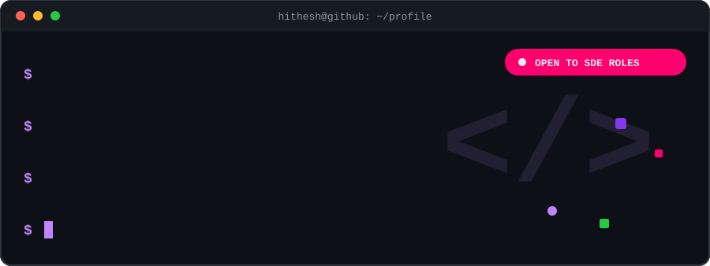
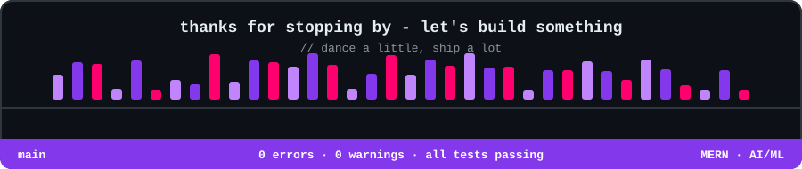

<div align="center">



<br/><br/>

[](https://hitheshx.vercel.app)
[](https://linkedin.com/in/hitheshamin)
[](mailto:hitheshamin423@gmail.com)
[](https://instagram.com/hitheshamin)

</div>

<br/>

## 👨‍💻 About Me

```ts
const hithesh = {
  education: "MCA @ MITE · 2026",
  focus: ["MERN", "AI API Integration"],
  outsideCode: ["Fitness", "Dance"],
  openTo: ["SDE Internships", "Fresher Roles", "Collaborations", "Open Source"],
};
```

<br/>

## 🛠️ Tech Stack

<div align="center">

**Languages**


**Frontend**


**Backend & Databases**


**AI / ML**


**Tools & Deployment**


</div>

<br/>

## 🚀 Featured Projects

<div align="center">

| | Project | What it does | Stack |
|:-:|:--|:--|:--|
| 💃 | **[DNCR / RhythmFlow](https://rhflow.vercel.app)** | Online dance studio management — classes, students, and fees in one place | `MongoDB` `Express` `React` `Node` |
| 💰 | **[Paisafy](https://paisafy.vercel.app)** | Smart finance advisor that recommends investment plans based on your goals | `React` `Node` `Flask` `ML` |
| 📋 | **[Niyam](https://niyamtrack.vercel.app/)** | Habit tracker built around consistency and streaks | `MongoDB` `Express` `React` `Node` |

</div>

<br/>

## 📊 GitHub Stats

<div align="center">


<br/><br/>


</div>

<br/>

## 🤝 Let's Connect

<div align="center">

Got an idea, an internship opening, or want to build something together?

**[📩 Email me](mailto:hitheshamin423@gmail.com)** · **[🌐 View portfolio](https://hitheshx.vercel.app)** · **[💼 LinkedIn](https://linkedin.com/in/hitheshamin)**

<br/>

*Found something useful? Drop a ⭐*

<br/>




</div>